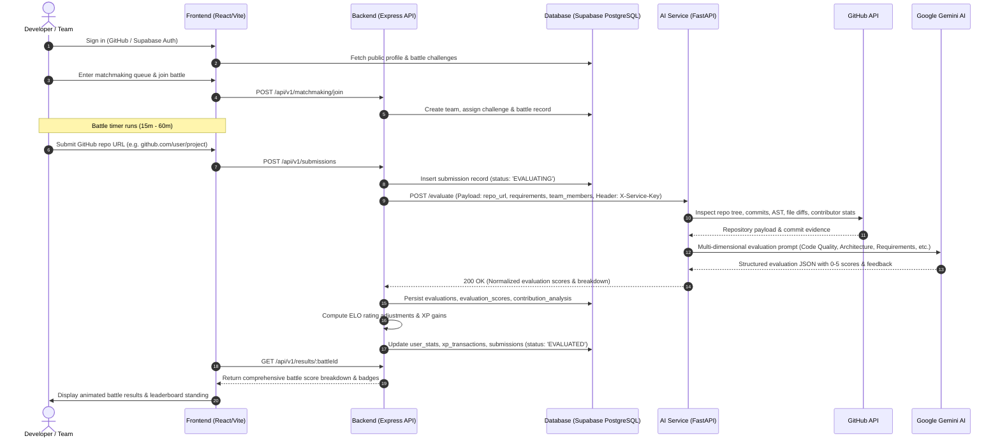

# KLYRO — Online Competitive Software Engineering Arena

> **A 6-week engineering challenge platform where developers build, battle, and showcase.**  
> *"Don't just show us what you built. Show us how you built it."*

---

## ⚡ Core Platform Loop

```
ENTER ➔ MATCH ➔ TEAM UP ➔ BATTLE ➔ BUILD ➔ SUBMIT ➔ GET JUDGED ➔ SCORE ➔ RANK ➔ LEVEL UP
```

Klyro is an online competitive software engineering arena where developers form teams, compete in real-time building battles, submit GitHub repositories, and receive multi-dimensional AI evaluation, XP rewards, ELO rating updates, and global leaderboard rankings.

---

## 🏛️ Monorepo Architecture & Service Ownership

```
Klyro/
├── frontend/             # Member 1 (React 18, Vite, Tailwind CSS, Framer Motion)
├── Backend/              # Member 2 (Node.js, Express, Supabase Service Client)
├── database/             # Member 2 (PostgreSQL Schemas, Migrations & Supabase DDL)
├── ai-service/           # Member 3 (Python FastAPI, GitHub API, Google Gemini LLM)
├── docs/                 # Shared Engineering Specifications & Documentation
└── .github/              # CI/CD Workflows & Pull Request Templates
```

### Service Directory Responsibilities

| Service | Primary Stack | Key Responsibilities | Port / Hosting |
| :--- | :--- | :--- | :--- |
| **`frontend/`** | React 18, Vite, Tailwind CSS, Lucide Icons | Responsive UI/UX, Auth Modal, Arena Battle Cockpit, Matchmaking Lobby, Showcase Gallery, Global Leaderboard, Battle Results Viewer | Port 5173 / Vercel |
| **`Backend/`** | Node.js 18+, Express, Supabase JS Client | REST API gateway, Supabase Auth verification, team formation, matchmaking queue, battle session management, AI evaluation orchestration, ELO & XP calculation | Port 5000 / Render |
| **`ai-service/`** | Python 3.10+, FastAPI, Google Gemini SDK, PyGithub | GitHub repo ingestion, commit tree / AST parsing, contribution analysis, multi-dimensional code judging via Gemini LLM, rubric score synthesis | Port 8000 / Render |
| **`database/`** | PostgreSQL 15+ (Supabase) | User profiles, battle instances, submissions, evaluations, skill categories, leaderboard cache, RLS security policies | Supabase Cloud |
| **`docs/`** | Markdown | Architecture design, API contract specifications, database ER diagrams, AI evaluation criteria | Static reference |

---

## 🔄 Frontend-Backend-AI Service Integration

The following diagram illustrates how the three microservices interact across a battle lifecycle:



---

## 💻 Quick Start & Local Development

### Prerequisites
- **Node.js** >= 18.0.0
- **Python** >= 3.10
- **Git**
- Active accounts on **Supabase**, **GitHub**, and **Google AI Studio**

---

### 1. Database Setup (Supabase)
1. Create a project at [Supabase](https://supabase.com).
2. Go to the **SQL Editor** in your Supabase project dashboard.
3. Run [`database/schema.sql`](database/schema.sql) to create core tables.
4. Run [`database/migration_phase4.sql`](database/migration_phase4.sql) to apply the Phase 4 additions (battles table, indexes, and constraints).
5. Copy your **Project URL**, **Anon Key**, and **Service Role Key** from **Project Settings > API**.

---

### 2. Backend Setup
```bash
cd Backend
# 1. Copy environment template
cp .env.example .env

# 2. Configure variables in .env (see Environment Variables section below)

# 3. Install dependencies
npm install

# 4. Run tests
npm test

# 5. Start development server
npm run dev
```
Backend runs at: **`http://localhost:5000`** (Health check: `http://localhost:5000/health`)

---

### 3. AI Service Setup
```bash
cd ai-service
# 1. Copy environment template
cp .env.example .env

# 2. Configure variables in .env (see Environment Variables section below)

# 3. Create and activate a Python virtual environment
python -m venv .venv
# On Windows:
.venv\Scripts\activate
# On Linux/macOS:
source .venv/bin/activate

# 4. Install dependencies
pip install -r requirements.txt

# 5. Run tests
python -m pytest tests/

# 6. Start FastAPI server
uvicorn main:app --reload --port 8000
```
AI Service runs at: **`http://localhost:8000`** (Docs: `http://localhost:8000/docs`, Health: `http://localhost:8000/health`)

---

### 4. Frontend Setup
```bash
cd frontend
# 1. Copy environment template
cp .env.example .env

# 2. Configure variables in .env (see Environment Variables section below)

# 3. Install dependencies
npm install

# 4. Run production build check
npm run build

# 5. Start Vite development server
npm run dev
```
Frontend runs at: **`http://localhost:5173`**

---

## 🔐 Environment Variables & Security Guide

> [!CAUTION]
> **NEVER commit real `.env` files or hardcode secrets into the source code.**  
> Always use `.env.example` templates and configure environment variables in your deployment dashboards (Vercel, Render, Supabase).

### 1. Frontend (`frontend/.env`)
| Variable | Description | Example / Default | Where to Configure |
| :--- | :--- | :--- | :--- |
| `VITE_API_BASE_URL` | Backend API URL | `http://localhost:5000` (Local) / `https://your-api.onrender.com` (Prod) | Vercel Project Environment Variables |
| `VITE_SUPABASE_URL` | Supabase project API URL | `https://your-project.supabase.co` | Vercel Project Environment Variables |
| `VITE_SUPABASE_ANON_KEY` | Supabase public anon key | `eyJhbGciOi...` | Vercel Project Environment Variables |

*Note: Only public, `VITE_`-prefixed keys are exposed in the browser bundle.*

---

### 2. Backend (`Backend/.env`)
| Variable | Description | Example / Default | Where to Configure |
| :--- | :--- | :--- | :--- |
| `PORT` | HTTP port for Express | `5000` | Render Environment Variables (auto-set) |
| `NODE_ENV` | Runtime environment | `development` or `production` | Render Environment Variables |
| `FRONTEND_URL` | Allowed origin for CORS | `http://localhost:5173` (Local) / `https://klyro.vercel.app` (Prod) | Render Environment Variables |
| `SUPABASE_URL` | Supabase project URL | `https://your-project.supabase.co` | Render Environment Variables |
| `SUPABASE_ANON_KEY` | Supabase public key | `eyJhbGciOi...` | Render Environment Variables |
| `SUPABASE_SERVICE_ROLE_KEY` | Supabase administrative service role key (bypasses RLS) | `eyJhbGciOi...` | Render Environment Variables (Secret) |
| `AI_SERVICE_URL` | Base URL of FastAPI AI service | `http://localhost:8000` (Local) / `https://klyro-ai.onrender.com` (Prod) | Render Environment Variables |
| `AI_SERVICE_KEY` | Shared internal secret token | Shared random high-entropy string | Render Environment Variables (Secret) |

---

### 3. AI Service (`ai-service/.env`)
| Variable | Description | Example / Default | Where to Configure |
| :--- | :--- | :--- | :--- |
| `GITHUB_TOKEN` | GitHub Personal Access Token (for repo & diff analysis) | `ghp_...` or fine-grained token | Render Environment Variables (Secret) |
| `GEMINI_API_KEY` | Google Gemini API Key | Secret key from [Google AI Studio](https://aistudio.google.com/) | Render Environment Variables (Secret) |
| `GEMINI_MODEL` | Gemini LLM Model Name | `gemini-2.5-flash` or `gemini-3.8-flash` | Render Environment Variables |
| `AI_SERVICE_KEY` | Shared internal authentication key | Must match `AI_SERVICE_KEY` in Backend | Render Environment Variables (Secret) |

---

## 🚀 Production Deployment Reference

### 1. Database (Supabase Cloud)
- Apply `database/schema.sql` and `database/migration_phase4.sql` via Supabase SQL Editor.
- Verify table creation and RLS policies.

### 2. AI Service (Render Web Service)
- **Environment**: Python 3
- **Build Command**: `pip install -r requirements.txt`
- **Start Command**: `uvicorn main:app --host 0.0.0.0 --port $PORT`
- **Environment Variables**: `GITHUB_TOKEN`, `GEMINI_API_KEY`, `GEMINI_MODEL`, `AI_SERVICE_KEY`

### 3. Backend Service (Render Web Service)
- **Environment**: Node
- **Build Command**: `npm install`
- **Start Command**: `node src/server.js`
- **Environment Variables**: `NODE_ENV=production`, `FRONTEND_URL`, `SUPABASE_URL`, `SUPABASE_ANON_KEY`, `SUPABASE_SERVICE_ROLE_KEY`, `AI_SERVICE_URL`, `AI_SERVICE_KEY`

### 4. Frontend Application (Vercel)
- **Framework Preset**: Vite
- **Build Command**: `npm run build`
- **Output Directory**: `dist`
- **Environment Variables**: `VITE_API_BASE_URL`, `VITE_SUPABASE_URL`, `VITE_SUPABASE_ANON_KEY`

---

## 🧪 Verification & Testing Status

| Service | Test Command | Results |
| :--- | :--- | :--- |
| **Backend** | `npm test` | **13/13 passing** (9 evaluation service unit tests + 4 end-to-end fixture mapping tests) |
| **AI Service** | `pytest tests/` | **42/42 passing** (Analyzer, API endpoints, LLM evaluator, scoring modules) |
| **Frontend** | `npm run build` | **Builds cleanly** (Vite production bundle generated successfully) |

---

## 📚 Technical Documentation Hub

For full system architecture specifications, check the [`docs/`](docs/) directory:
- [ARCHITECTURE.md](docs/ARCHITECTURE.md) — System design, data pipelines & component boundaries
- [API_CONTRACT.md](docs/API_CONTRACT.md) — REST API endpoints, schemas & payloads
- [DATABASE_SCHEMA.md](docs/DATABASE_SCHEMA.md) — PostgreSQL ER diagrams & table dictionary
- [AI_EVALUATION.md](docs/AI_EVALUATION.md) — 6-dimension evaluation framework & LLM judging rubrics
- [DEPLOYMENT.md](docs/DEPLOYMENT.md) — Step-by-step production deployment manual
- [DEVELOPMENT.md](docs/DEVELOPMENT.md) — Local developer workflows and contribution guidelines
